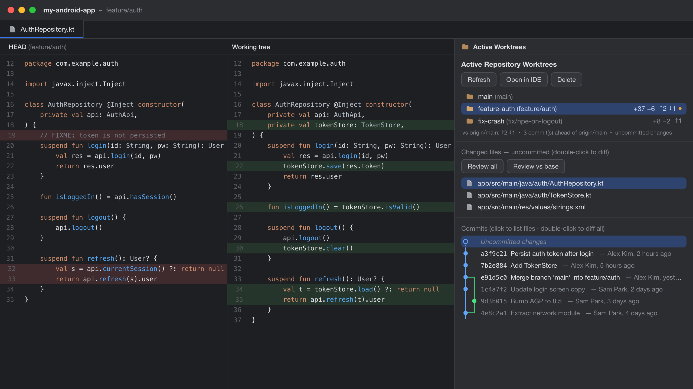

# AI Worktree Reviewer


> A JetBrains IDE plugin for reviewing changes across multiple Git worktrees
> without leaving your editor — built for the era of AI coding agents that work
> several branches in parallel.

<p align="center">
  
</p>

## What it is

AI Worktree Reviewer adds an **Active Worktrees** tool window to IntelliJ IDEA
and Android Studio. When a repository has several Git worktrees, it lists them
in one place and lets you review each worktree's changes with a side-by-side
diff — without switching projects or running git by hand.

## Why

AI coding agents (Claude Code and friends) make it common to run several work
branches at once via `git worktree`. Hopping between worktrees with `cd` or
separate IDE windows just to answer "what did this branch change?" is tedious.

This plugin keeps a tight review loop — **worktree list → changed files →
diff** — in a single panel, so you can review parallel work at a glance.

## Features

| Feature | Description |
|---------|-------------|
| **Active Worktrees tool window** | Lists active worktrees (`git worktree list`) in the right dock |
| **Change badges** | Shows `+insertions -deletions` per worktree, including untracked files |
| **Branch-status badges** | `↑ahead ↓behind` against the tracked upstream, plus a `●` marker when the tree is dirty |
| **Branch-status summary** | One line for the selected worktree: upstream sync, commits added on top of the base branch, clean/dirty |
| **Commit graph** | The worktree's history drawn as a colored lane graph — branches and merges included. Commits the base branch already contains are dimmed, so the fork point is visible at a glance |
| **Uncommitted node** | A dashed, hollow node sits on top of `HEAD` when the tree is dirty, and is selected on open so uncommitted work shows immediately |
| **Changed-file browsing** | Lists the selected worktree's uncommitted changes, refreshed on every click |
| **Commit mode** | Click a commit to list the files it touched — merge commits included; double-click to page through the whole commit as one diff |
| **Single-file diff** | Double-click a file to diff it — `HEAD` ↔ working tree for uncommitted changes, or parent ↔ commit in commit mode |
| **Review all** | Pages through every changed file in a single, reused diff tab |
| **Review vs base** | Diffs everything the branch adds since its **merge-base** with the trunk, so commits landed on the base after the fork are not attributed to this branch |
| **Open in IDE** | Opens the selected worktree as a project in a new window |
| **Delete** | Removes the selected worktree after confirmation (`git worktree remove`) and closes its open diff |
| **Refresh** | Reloads worktrees and stats, and re-detects the base branch |
| **Shortcut** | `Alt+Shift+W` toggles the tool window (also added to the Git menu) |

> **What's compared:** the default view diffs each file's committed version (`HEAD`)
> against the working tree — the worktree's **uncommitted** changes. Selecting a
> commit switches to that commit's own delta (parent ↔ commit), and **Review vs
> base** compares the merge-base with the trunk against the working tree.

> The base branch is auto-detected: `origin/HEAD` → `origin/main` → `origin/master`
> → `main` → `master`, first one that resolves.

> All git calls run on a background thread with a hardened environment and a
> timeout, so the IDE UI never freezes or blocks on a credential prompt.

## Requirements

- **IntelliJ IDEA 2024.1**, **Android Studio Koala (2024.1.1)**, or newer for plugin `1.1.3` (IntelliJ Platform build `241` or newer)
- The bundled **Git4Idea** plugin (enabled by default)

## Installation

### Option A — Install the release ZIP (recommended)

1. Download `aiworktreereviewer-*.zip` from the
   [Releases](https://github.com/comeyap/AI-Worktree-Reviewer-for-AndroidStudio-IntelliJ/releases) page.
2. In your IDE, open **Settings/Preferences → Plugins**.
3. Click the gear icon (⚙️) → **Install Plugin from Disk…** and select the downloaded `.zip`.
4. Restart the IDE. The **Active Worktrees** tool window appears in the right dock.

### Option B — Build from source

```bash
cd plugin
./gradlew test             # unit + git-integration tests
./gradlew buildPlugin      # → plugin/build/distributions/aiworktreereviewer-<version>.zip
```

Then install the produced ZIP via Option A, step 3. To launch a sandbox IDE with
the plugin preinstalled:

```bash
cd plugin
./gradlew runIde
```

> The build uses the Gradle wrapper (`9.5.1`) and JDK 17, with IntelliJ Platform
> Gradle Plugin `2.20.1`, Kotlin `2.4.21`, and IntelliJ Platform `2024.1`.

## Usage

1. Open a project that has Git worktrees (e.g. `git worktree add ../feature-x -b feature-x`).
2. Open **Active Worktrees** with `Alt+Shift+W`, or from the right dock.
3. Select a worktree. Its badges show how far it is ahead/behind, the changed-file
   list shows uncommitted work, and the commit graph shows the branch's history.
4. **Double-click a file** to diff it, or **Review all** to page through every change.
5. **Click a commit** in the graph to list its files, or **double-click** it to review
   the whole commit. **Review vs base** shows everything the branch adds over the trunk.
6. Use **Open in IDE / Delete** to manage the worktree itself.

## License

Apache-2.0
